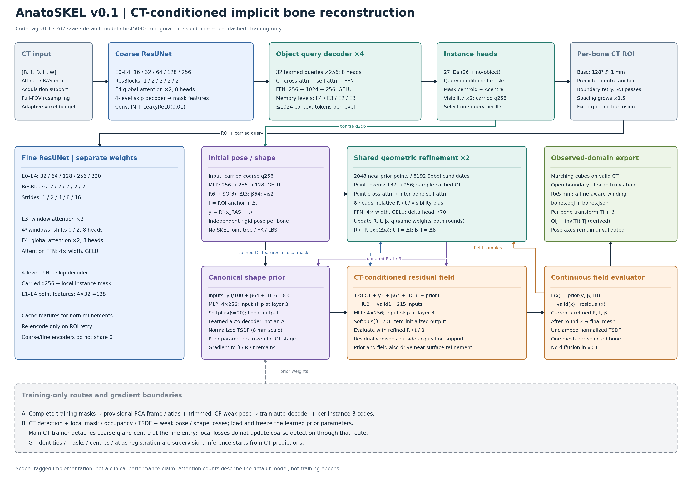
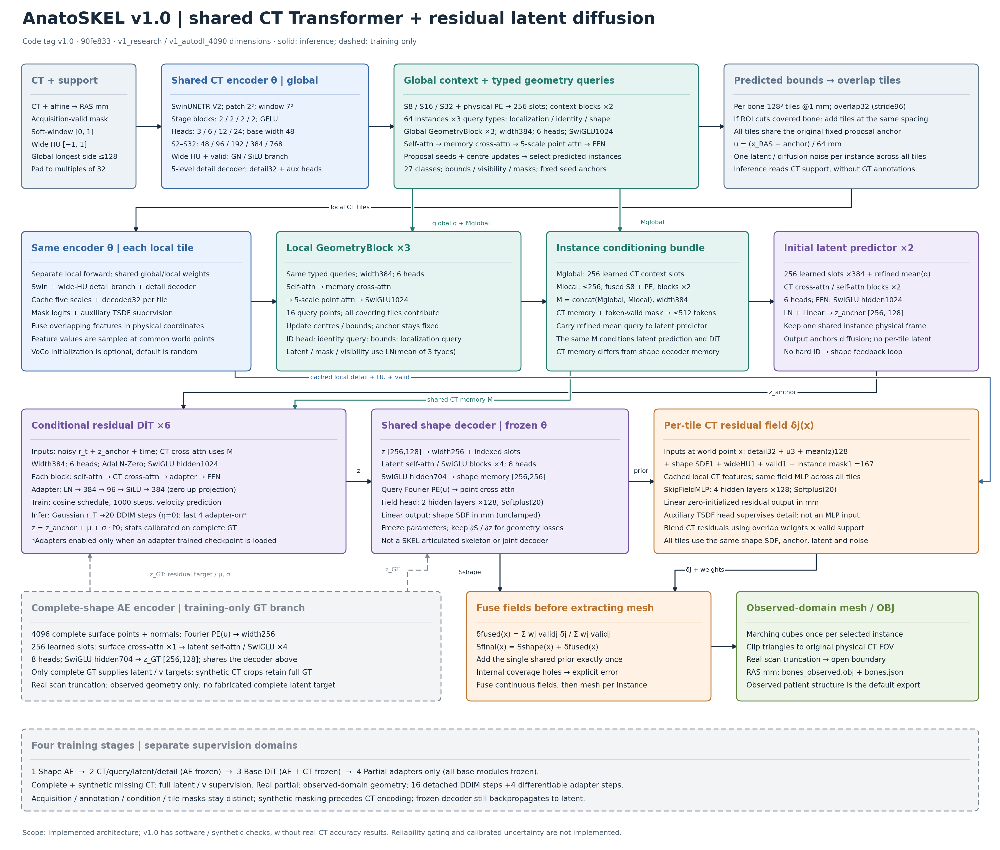

# AnatoSKEL

**CT → 逐椎体几何查询 → 条件潜空间扩散 → 扫描范围内的 3D 骨表面**

首期任务是 VerSe 腰椎重建。v1.0 已实现共享 Swin Transformer、物理坐标下的结构化查询、完整形状 AE、残差 DiT、真实截断病例的采样末段 adapter，以及多 tile 连续场融合。输出为 RAS 毫米坐标的 `bones_observed.obj + bones.json`。

版本记录：

- **v0.1**：Git 标签 `v0.1`，保存首轮 CNN/attention/形状先验基线及已有演示。首轮真实训练结果见 [first5090](docs/first5090.md) 和 [示例](examples/first5090/README.md)。
- **v1.0**：新版 Transformer 与扩散实现。已完成软件测试和合成四阶段训练/导出检查，尚无新版真实 CT 训练精度结果。v0.1 权重不能直接加载为 v1.0 权重。

代码与数据集按各自许可管理；医学影像、训练权重和新生成结果不提交 Git。GitHub 仓库保持私密。实现借鉴 HSMR/VGGT 的结构化几何推理，不依赖受限 SMPL/SKEL 资产或 RGB 模型权重。

## 模型架构图

按两个版本标签的实际代码绘制，包含层数、注意力头、FFN 激活函数、训练支路与 OBJ 导出流程。[图解与代码依据](docs/architecture_figures.md)。

**v0.1：独立粗/细 ResUNet → 几何查询细化 → 隐式先验 + CT 残差场。** [SVG](docs/figures/anatoskel-v0.1-architecture.svg)



**v1.0：共享 Swin → 结构化查询 → 残差潜空间扩散 → 多 tile 连续场融合。** [SVG](docs/figures/anatoskel-v1.0-architecture.svg)



## 本地环境

Miniforge 环境 `anatoskel`，Python **3.11**、PyTorch **2.8.0**、MONAI **1.5.1**、einops **0.8.1**。AutoDL 继续使用 **PyTorch 2.8.0+cu128 / CUDA 12.8**；macOS 使用 CPU wheel。

```bash
conda activate anatoskel
python -m pip install -e '.[dev]'
ruff check .
pytest -q
python scripts/smoke_v1.py
```

合成检查产物仅用于软件流程验证，不代表医学重建效果。详见 [v1.0 架构与运行说明](docs/v1.md)，服务器安装见 [AutoDL](docs/autodl.md)。

## v1.0 训练

四阶段依次运行 `train-v1 --stage shape/ct/diffusion/partial`，后续阶段通过 `--init` 加载前一阶段 checkpoint；同一阶段通过 `--resume` 继续。完整命令见 [训练流程](docs/v1.md#training-stages)。

```bash
anatoskel train-v1 --stage shape --config configs/v1_autodl_4090.yaml \
  --manifest data/verse/processed/manifest.jsonl --output outputs/v1/shape --device cuda
```

采用现有去重 VerSe 2019/2020 数据与患者级划分。完整骨体训练形状 AE 和标准扩散；真实截断骨体通过可靠可见域损失训练，不伪造完整 latent 真值。人工缺失在 CT 编码前生成，完整 GT 仅进入损失。

若使用 VoCo-B 预训练，先在配置中指定 `model.pretrained_encoder`。代码会检查实际加载覆盖率；未指定权重时使用随机初始化，不宣称已使用预训练。

默认每个 CT 步处理一份全局影像和最多两个骨实例，使用 BF16 与梯度 checkpoint。24GB/32GB 显卡的实际峰值和速度仍需在服务器测量后确定。

## 推理与输出

```bash
anatoskel infer --checkpoint outputs/v1/partial/model.pt \
  --manifest data/verse/processed/manifest.jsonl --split test \
  --output outputs/v1/prediction --device cuda
```

推理只读取 CT 与扫描覆盖，不使用 GT 标签、GT 中心或标注有效域。所有 tile 共用同一实例参考系及同一扩散 latent，融合场后统一提取网格。真实扫描截断处保留开放边界，默认不导出扫描外生成的完整骨体。JSON 保存坐标、覆盖、截断与训练来源说明。

旧版 `train-prior`、`train`、`scripts/run_autodl.py` 及旧配置保留用于 v0.1 复现；旧模型架构见 [baseline architecture](docs/architecture.md)。`infer` 与 `evaluate` 按 checkpoint schema 自动选择版本。
