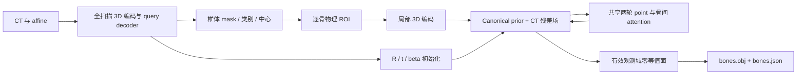

# AnatoSKEL

**Patient-Specific Bone Reconstruction from CT with Anatomical Shape Priors**

研究代码：CT 体数据 → 椎体实例与编号 → 独立刚体姿态、形状先验与 CT 残差场 → 患者坐标下的骨表面。
首期针对 VerSe 腰椎，骨盆作为后续任务。

当前已实现本地可运行的模型、prior/主模型训练、预测 ROI 推理、验证与 `OBJ + JSON` 导出。
仅做过合成数据的软件验证，没有真实 CT 训练权重或医学重建性能结果。
合成 checkpoint 有明确标记，默认不能作为普通推理权重使用。

实现借鉴 [HSMR](https://github.com/IsshikiHugh/HSMR) 的图像特征→参数查询与
[SKEL](https://github.com/MarilynKeller/SKEL) 的形状/姿态分离思想。
这里重新实现 CT 编码和逐椎体隐式几何，不依赖 SMPL/SKEL 受限模型资产或其人体 RGB 权重。
代码 MIT；训练数据按各自许可管理，医学影像、权重与生成网格默认不提交 Git。

## 本地环境

已创建 Miniforge 环境 `anatoskel`：Python **3.11.16**、PyTorch **2.8.0**。

```bash
conda activate anatoskel
cd /Users/shuxing/AIlearning/AnatoSKEL
anatoskel doctor
pytest -q
```

在另一台机器复建本地环境：`conda env create -f environment-local.yml`。
Linux 服务器使用 **PyTorch 2.8.0+cu128 / CUDA 12.8 / Python 3.11**，
安装命令、驱动与系统要求见 [AutoDL 配置](docs/autodl.md)。本地 macOS 不安装 CUDA。

## 验证完整软件流程

```bash
python scripts/smoke.py
```

该命令只生成小型椭球 NIfTI，检查 prior 优化、主模型反向传播、checkpoint、推理、验证与参考网格导出。
结果在 `outputs/smoke/`；`reference/` 是标注表面，`prediction/` 是模型实际预测，两者元数据明确区分。
只训练几个步骤时预测可能为空或错误，这不是医学性能演示。

## 真实数据流程（准备好数据后执行）

采用 **去重的 VerSe 2019/2020 完整重组版**，详见 [数据集与 manifest](docs/datasets.md)。
本轮未下载真实数据。数据路径通过 JSONL 明确指定；跨患者拆分、重复路径、未知标签与 affine 不一致会报错。

```bash
anatoskel inspect-data --manifest data/verse/manifest.jsonl
anatoskel build-atlas --manifest data/verse/manifest.jsonl --output outputs/atlas.json
anatoskel train-prior --config configs/research.yaml --manifest data/verse/manifest.jsonl \
  --atlas outputs/atlas.json --output outputs/prior --device cuda
anatoskel train --config configs/research.yaml --manifest data/verse/manifest.jsonl \
  --prior outputs/prior/prior.pt --output outputs/train --device cuda
anatoskel evaluate --checkpoint outputs/train/model.pt --manifest data/verse/manifest.jsonl \
  --split val --output outputs/val.json --device cuda
anatoskel infer --checkpoint outputs/train/model.pt --manifest data/verse/manifest.jsonl \
  --split test --output outputs/prediction --device cuda
```

Atlas 只用完整、稳定的训练骨实例建立固定 canonical frame；PCA 只作初始化。
多起点 trimmed ICP 提供弱姿态质量标志；部分视野、轴对称或配准多解时关闭姿态监督。
**配准通过不代表解剖轴获得临床验证**。真实数据阶段需要人工检查模板/配准质量与有效域，再决定接受哪些弱标签。
不提供 atlas 时允许训练 provisional PCA prior，但不能据此宣称解剖姿态精度。

主训练分开反传粗/细分支，以释放全扫描激活；粗 query 在细分支入口 detach。
ROI 从 GT 中心加扰动逐步切换到预测中心，预测阶段漏裁不会用 GT ROI 补回。
验证始终使用预测 ROI，并将未检测到的 GT 骨记为 Dice=0。
训练定期保存 optimizer、扫描位置和随机状态；继续使用 `anatoskel train ... --resume outputs/train/model.pt`。

## 架构与输出

完整规格见 [模型架构](docs/architecture.md)，研究配置见 [research.yaml](configs/research.yaml)。
卷积 LeakyReLU(0.01)，attention FFN 使用 GELU，隐式场 MLP 使用 Softplus(β=20)，场输出为线性。



`bones.obj` 每块骨一个对象；坐标是 **RAS 毫米**。
`bones.json` 保存 CT affine、骨编号、刚体变换、形状代码、相对变换、可见性和边界信息。
OBJ 本身没有单位和骨架层级，因此 JSON 必须与它一起保存。
原 CT 外部不生成可信表面；截断边界保持开放，不人为封口。病理残差没有固定幅度上限。
当前输出是静态骨表面与关系，不能代表骨小梁、皮质厚度、关节运动学或骨折碎片实例。

24GB 配置采用体素/token 预算、BF16、梯度检查点和每步最多两个骨 ROI；
尚未在 4090/5090 测显存。租机后首先执行 `doctor --require-cuda` 并测研究配置峰值。
测试与合成模型能验证代码链路，不能替代真实数据训练和外部验证，也不能证明论文创新性。
