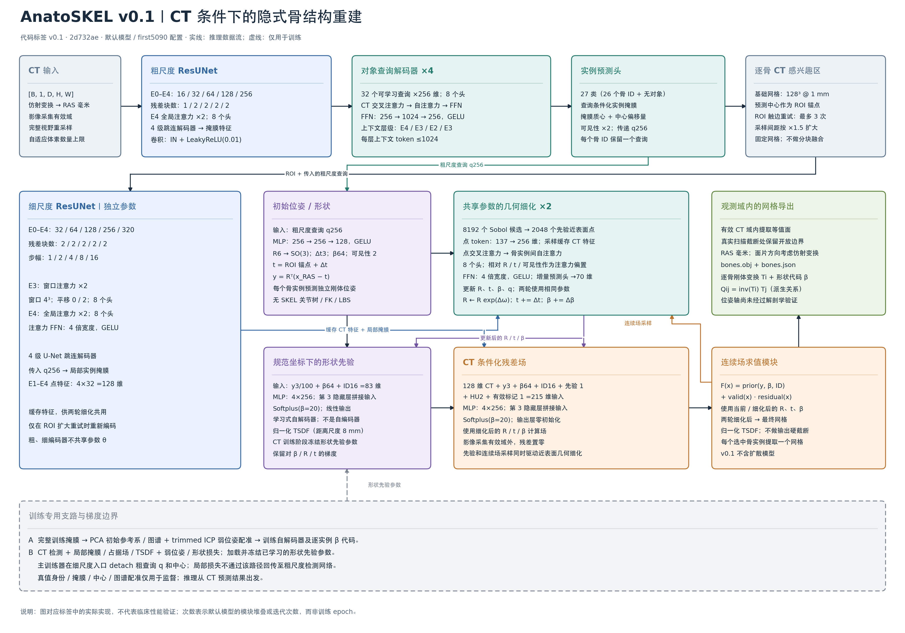
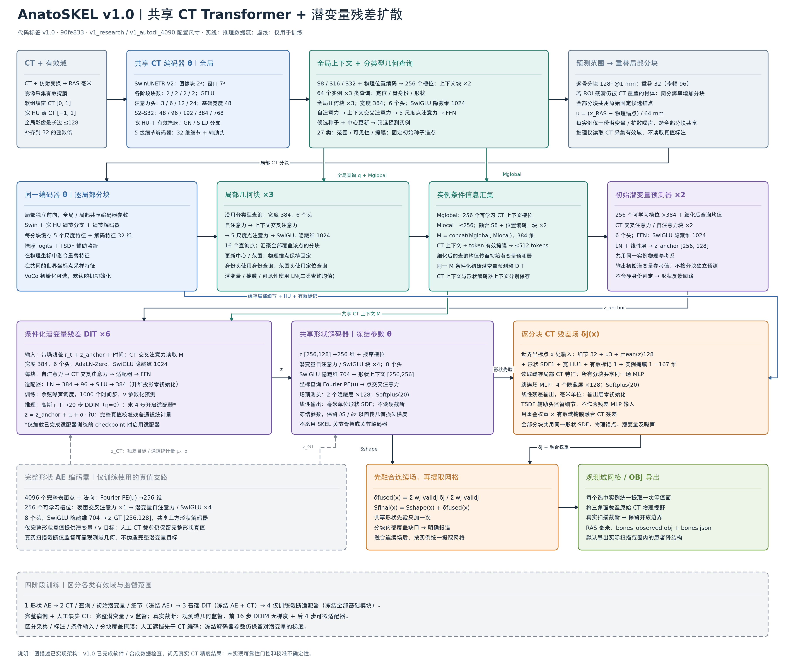

# AnatoSKEL 版本架构图

架构图提供中、英文两套，分别对应已保存的 Git 标签 **v0.1（`2d732ae`）**和 **v1.0（`90fe833`）**，依据实际实现与默认研究配置绘制。中英文版共用布局与数据流，公式、变量名和常用模型缩写保持一致。图中次数表示模块堆叠或迭代次数，非训练 epoch；实线表示推理数据流，虚线表示训练专用支路。跨模块传递的查询、上下文和缓存特征在框内注明，箭头对主流程作概括。

## v0.1：双编码器与隐式形状先验


[英文 SVG](figures/anatoskel-v0.1-architecture.svg) · [英文 PNG](figures/anatoskel-v0.1-architecture.png) · [详细架构说明](architecture.md)



[中文 SVG](figures/anatoskel-v0.1-architecture-zh.svg) · [中文 PNG](figures/anatoskel-v0.1-architecture-zh.png)

- 粗、细两个 ResUNet **参数独立**。粗查询解码器为 4 层、32 个对象查询；细编码器含窗口和全局注意力，再进行 2 轮共享几何细化。
- 形状先验是学习的 **auto-decoder**；PCA 只用于初始坐标参考系，不是形状基底。查询预测逐骨 `R/t/β64`，由先验 TSDF 与 CT 残差共同构成最终连续场。
- 基础 ROI 为 `128³ @ 1 mm`。触边重试增大采样间距扩大范围，最多 3 次；此版本没有 v1.0 的同分辨率多 tile 融合。
- 训练主流程在 coarse→fine 入口 detach 查询和中心；冻结先验参数仍保留其输入梯度。推理只输出 CT 观测范围内的 `bones.obj`，真实扫描截断处保留开放边界。

实现依据：[配置](https://github.com/Shukeke03/AnatoSKEL/blob/v0.1/src/anatoskel/config.py)、[编码器](https://github.com/Shukeke03/AnatoSKEL/blob/v0.1/src/anatoskel/models/encoder.py)、[查询检测](https://github.com/Shukeke03/AnatoSKEL/blob/v0.1/src/anatoskel/models/detector.py)、[几何后端](https://github.com/Shukeke03/AnatoSKEL/blob/v0.1/src/anatoskel/models/backend.py)、[推理](https://github.com/Shukeke03/AnatoSKEL/blob/v0.1/src/anatoskel/inference.py)。

## v1.0：共享 Transformer 与残差潜空间扩散


[英文 SVG](figures/anatoskel-v1.0-architecture.svg) · [英文 PNG](figures/anatoskel-v1.0-architecture.png) · [详细架构说明](v1.md)



[中文 SVG](figures/anatoskel-v1.0-architecture-zh.svg) · [中文 PNG](figures/anatoskel-v1.0-architecture-zh.png)

- 全局 CT 与局部 tile **共用 Swin 编码器参数**，分别执行前向；Swin 四阶段各 2 个 block。结构化查询为 `64×3`，全局和局部各 3 层，使用物理坐标采样与 SwiGLU FFN。
- 定位、身份、形状三种查询共同参与注意力；latent 预测使用三者均值经 LayerNorm 后的表示。定位查询负责中心和范围，身份查询负责分类。形状参考 anchor 固定为初始 proposal seed，后续中心更新不移动它。
- 全局 256 个 CT context slots 与局部最多 256 个 CT tokens 拼接，条件化 2 层 latent predictor 和 6 层 DiT。每个实例共享 `256×128` latent；1000 步扩散训练，推理使用 20 步 DDIM。仅 adapter 训练过的 checkpoint 在末 4 步启用 adapter。
- 完整形状 AE 的 GT 编码只用于训练。后续冻结形状解码器参数，几何损失仍通过解码器更新 latent、DiT 或 adapter。真实截断实例没有完整 latent/v 监督，只使用可靠观测域；人工 CT 裁剪使用确实完整的形状 GT。
- 所有 tile 共用同一实例物理参考系、latent 和扩散噪声。按物理坐标融合 **CT 残差场**，共享形状先验只加一次，再统一提取网格并裁到原始 CT FOV，输出 `bones_observed.obj`。人工 ROI 面仍有骨且面外 CT 仍有效时扩展 tile；内部覆盖缺口直接报错。
- 四阶段训练：形状 AE → CT/查询/初始 latent/局部细节 → 基础 DiT → 末段 adapter。图描述已实现的软件架构；v1.0 尚无真实 CT 训练精度结果。默认配置没有加载 VoCo 预训练权重。

实现依据：[研究配置](https://github.com/Shukeke03/AnatoSKEL/blob/v1.0/configs/v1_research.yaml)、[共享编码器](https://github.com/Shukeke03/AnatoSKEL/blob/v1.0/src/anatoskel/v1/encoder.py)、[查询与 CT memory](https://github.com/Shukeke03/AnatoSKEL/blob/v1.0/src/anatoskel/v1/queries.py)、[形状 AE](https://github.com/Shukeke03/AnatoSKEL/blob/v1.0/src/anatoskel/v1/shape.py)、[DiT](https://github.com/Shukeke03/AnatoSKEL/blob/v1.0/src/anatoskel/v1/diffusion.py)、[连续场](https://github.com/Shukeke03/AnatoSKEL/blob/v1.0/src/anatoskel/v1/network.py)、[推理与融合](https://github.com/Shukeke03/AnatoSKEL/blob/v1.0/src/anatoskel/v1/inference.py)。

## 编辑与重绘

[绘图源文件](figures/draw_architectures.py)使用 Matplotlib，自动检查框中文字是否溢出，生成中英文 SVG 和 PNG。[中文词条](figures/architecture_zh.json)单独维护，缺失译文时停止渲染。SVG 将字体转为矢量路径以保持跨设备显示一致；浏览或使用已生成的图无需安装字体。PNG 分辨率分别为 `3600×2520`、`3600×3060`。

```bash
# 仅重绘文档图时需要；不是训练依赖。
python -m pip install matplotlib==3.10.7
python docs/figures/draw_architectures.py --language all
# 只重绘中文版，保留英文文件不动：
python docs/figures/draw_architectures.py --language zh
```

重绘中文版时需已安装中文字体，如 Noto Sans CJK SC、思源黑体或 macOS 黑体；当前中文版使用 macOS 的 STHeiti，公式和拉丁字符使用 DejaVu Sans。

中英文图作为文档提交保存在 `main`，不移动原有 `v0.1` / `v1.0` 标签，不修改模型代码或训练产物。
