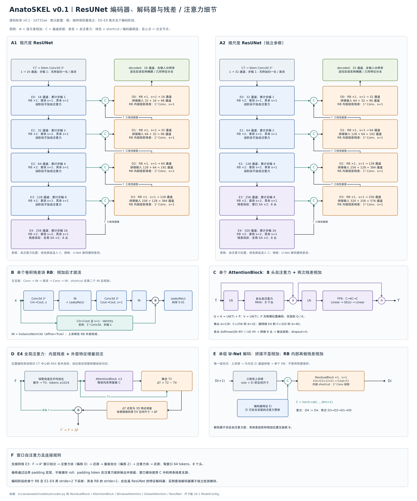

# v0.1 ResUNet 与特征解码器细节

对应 Git 标签 `v0.1`（`2d732ae`）的默认 `ModelConfig`，覆盖粗、细两个独立编码器以及各自的 U-Net 特征解码器。

[高清 PNG](figures/anatoskel-v0.1-resunet-detail-zh.png) · [矢量 SVG](figures/anatoskel-v0.1-resunet-detail-zh.svg) · [绘图源文件](figures/draw_v01_resunet.py)

## 残差和跳连接在哪里

1. **卷积残差块（图 B）**：主支路为 `Conv3³ → IN → LeakyReLU → Conv3³ → IN`。输入 shortcut 在第二个 IN 后与主支路**相加**，再执行最后的 `LeakyReLU(0.01)`。通道相同且 stride=1 时 shortcut 为 Identity；其他情况使用 `1³ Conv` 匹配通道和步幅。
2. **自注意力块（图 C）**：先进行 `T + MHA(LN(T))`，再进行 `T + FFN(LN(T))`，因此每块有两次残差相加。物理位置编码只加入注意力的 Q、K，V 使用归一化后的特征。FFN 为 `Linear(C,4C) → GELU → Linear(4C,C)`。
3. **E4 全局注意力包装器（图 D）**：除了注意力块内部残差，还有 `F + ΔF`。令池化后的初始 tokens 为 T0，两个注意力块输出为 T2，计算 `ΔT=T2−T0`，还原并按需插值到原始 E4 尺寸，再与原始特征 F 相加。
4. **U-Net 编码器到解码器的跳连（图 A、E）**：编码器特征 Ei 与上采样后的解码器特征沿通道维**拼接**，不是相加。拼接结果进入一个卷积残差块；该块内部仍按图 B 做投影和残差相加。

图中 `⊕` 表示逐元素相加，`C` 表示通道拼接；实心点表示分支节点，交叉线无实心点时不连接。

## 自注意力放在哪里

注意力均位于相应编码阶段的卷积残差块之后。缓存、传给下一级以及 U-Net 跳连使用的都是注意力更新后的特征。

| 网络与位置 | 类型 | 堆叠次数 | 并行头数 | 特征宽度 / 每头宽度 |
|---|---|---:|---:|---:|
| 粗尺度 E4 | 全局自注意力 | 2 | 8 | 256 / 32 |
| 细尺度 E3 | 窗口自注意力，窗口 `4³` | 2 | 8 | 256 / 32 |
| 细尺度 E4 | 全局自注意力 | 2 | 8 | 320 / 40 |

“8 个头”表示同一个 MHA 中并行的 8 组 Q/K/V 运算；“×2”表示两个顺序堆叠、参数独立的注意力块。细尺度 E3 两个块使用窗口偏移 0 和 2，通过 padding 改变划分，不进行循环 roll。全局注意力按需池化，使 token 数不超过 1024。**U-Net 特征解码器没有另设注意力层**。

## 解码器逐级通道

解码从已经过全局注意力更新的 E4 开始。各级执行三线性插值到对应 Ei 的实际尺寸，再拼接 Ei，并用单个 stride=1 的残差块输出。插值设置 `align_corners=False`。

| 级别 | 粗尺度：拼接 → 输出通道 | 细尺度：拼接 → 输出通道 |
|---|---|---|
| D3 | 256 + 128 = 384 → 128 | 320 + 256 = 576 → 256 |
| D2 | 128 + 64 = 192 → 64 | 256 + 128 = 384 → 128 |
| D1 | 64 + 32 = 96 → 32 | 128 + 64 = 192 → 64 |
| D0 | 32 + 16 = 48 → 16 | 64 + 32 = 96 → 32 |

由于拼接后的通道数大于输出通道数，四个解码级的残差 shortcut 都使用 `1³ Conv` 投影。累计步幅是编码器采样步幅，实际空间尺寸取决于输入和卷积结果。

## 与实例查询解码器的区别

这里展开的是 **ResUNet 内部的特征解码器**。独立的粗尺度实例检测模块另有 4 层 QueryBlock，处理 `32×256` 查询，依次读取 E4/E3/E2/E3；每层为交叉注意力 → 自注意力 → GELU FFN，每个子层均有残差相加，注意力均为 8 头。两者在[整体架构图](architecture_figures.md)中分别标出。

源码依据：[ResidualBlock、AttentionBlock、注意力包装器与 ResUNet](https://github.com/Shukeke03/AnatoSKEL/blob/v0.1/src/anatoskel/models/encoder.py)、[默认配置](https://github.com/Shukeke03/AnatoSKEL/blob/v0.1/src/anatoskel/config.py)、[实例查询解码器](https://github.com/Shukeke03/AnatoSKEL/blob/v0.1/src/anatoskel/models/detector.py)。

重绘：`python docs/figures/draw_v01_resunet.py`，使用与整体架构图相同的 Matplotlib 和中文字体。输出为 `3600×4320` PNG 与字体转路径的 SVG。
